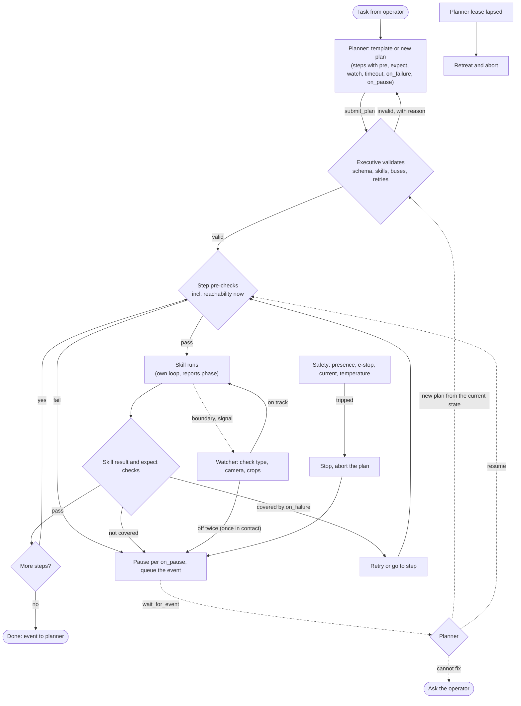

# ADR-0006: Plan, execute, watch: task execution with a planner, a behaviour-tree executive and a visual watcher

- Status: Proposed
- Date: 2026-10-31

## Context

The robot can drive, move its arms and head, and find objects (ADR-0005). An agent drives it through the MCP server one
call at a time. That works for single actions, but a task ("put the yellow cube in the bin") needs tens of steps:
calling a large model for each is slow and costly, and nothing watches between calls.

A fixed script cannot reason about a failure it was not written for. What is wanted is a large model that reasons and
plans, an executive on the robot that runs the plan with its closed loops and safety, and a cheap, fast observer that
notices when reality leaves the plan and wakes the planner.

Constraints:

- The Jetson Orin NX (16 GB) holds the stack and the perception models; its CPU is the bottleneck. A GPU workstation on
  the network has headroom but is not in the ROS graph, so it is reached over HTTP like the perception backends.
- Vision-language models answer in hundreds of milliseconds to seconds; they cannot be in a control or safety loop.
- The arms reach to about 5 mm open loop, the head-to-arm calibration agrees to about 7 mm, and grasping waits for the
  parallel gripper. The first task is "drive to the desk, find the cube, touch it".
- Motion through MCP already requires an operator presence heartbeat; losing it stops the motion and e-stops the bus.

## Decision

| Layer | Rate | Runs on | Role |
|---|---|---|---|
| Planner | on request and on events | a large model through MCP | turns a task into a plan, repairs it from the current state, or asks the operator |
| Executive | 10-50 Hz | Jetson, its own ROS node | validates and runs the plan, checks conditions, retries what the plan allows, queues events |
| Skills | own loops, 10-100 Hz | Jetson | one capability each, ROS 2 actions with typed results |
| Safety | every control cycle | Jetson | presence, e-stop, servo current and temperature, tracking error, timeouts; deterministic only |
| Watcher | at step boundaries and on signals | GPU workstation | checks with camera frames what the executive cannot check itself |

### Plans

The planner writes a plan as a JSON document; the executive validates it and runs it. Version 1 plans are flat
sequences: each step has `on_failure: retry <n> | goto <step> | abort`, and a small state machine runs them. Trees with
fallback branches come later, once logged plans show where they are needed, run by `py_trees`.

Schema (version 1):

- `schema_version`, `plan_id`, `task` (the operator's request);
- `objects`: bindings from scene IDs (see Scene graph) to label, pose in `map`, size and time seen;
- per step: `id`, `skill`, typed parameters with units and frames, `pre` and `expect` as checks from a fixed predicate
  list (`detected(obj)`, `object_within(obj, pose, tol_mm)`, `joint_near(group, position, tol)`, `at_pose(frame, tol)`,
  `contact(arm)`, `gripper_holds(arm)`), `expect_text` (a hint for the watcher only), `watch` (camera, target objects,
  check types), `timeout_s`, `on_failure` with a bounded retry count and the result codes it covers, and `on_pause`
  (`hold`, `retreat <named pose>` or `stop_base`).

Validation runs twice. Before running: schema, known skills and parameters, finite retries, no two motion steps on
the same servo bus at once, and no `on_failure` that covers `SAFETY_STOP` or `PREEMPTED`. Before each step: its `pre`
checks, including reachability from the base pose at that moment. A failed validation returns the reason to the
planner.

A step completes only when its skill reports `SUCCEEDED` and its `expect` checks pass. Repair means a new plan from the
current state, never an edit of the running one; `resume` restarts the current step after re-checking its `pre`.

Recurring tasks become plan templates with parameters ("touch `object`", later "put `object` in `container`"), made
from logged plans that worked; the planner fills a template when one fits.

Before a plan runs on the robot, it can be dry-run against mock hardware or the Isaac Sim twin.

### Skills

ROS 2 actions on the Jetson with a common contract: typed goal parameters, feedback with a phase name, and a result
code from a fixed list: `SUCCEEDED`, `TIMEOUT`, `NOT_REACHABLE`, `NOT_FOUND`, `AMBIGUOUS`, `LOST_OBJECT`, `COLLISION`,
`SAFETY_STOP`, `PREEMPTED`. Each skill checks the presence heartbeat itself and stops with `SAFETY_STOP` when it lapses.

Version 1: `navigate_to` (waypoint or pose), `look_at`, `detect` (ADR-0005), `move_arm` (named position or Cartesian
point), `approach` (a pose above an object), `touch`. `touch` moves down until contact, sensed by servo current or
tracking error, with a threshold below the safety supervisor's, a maximum travel past the expected contact point, and
`SUCCEEDED` only within that travel. Grasp, lift and place are added with the parallel gripper.

### Safety, pause and the planner's absence

- An e-stop from anywhere (the joystick, the TUI, MCP) aborts the plan. A safety stop is never retried by the plan;
  only the planner's `resume` continues, and only after presence is back and the servos are confirmed torqued.
- Pausing has a physical meaning per step (`on_pause`): hold the position, retreat to a named pose, or stop the base.
  A held arm draws current against gravity, so a pause lasts at most `max_hold_s`; after that the executive retreats,
  stows the arms and aborts.
- The planner holds a lease that every `wait_for_event` call renews. If it lapses (the agent ended or lost the
  connection), the executive finishes or pauses the current step, retreats and aborts. The executive does not depend
  on the MCP server's process: it keeps the plan and the event queue, and a new agent session can attach to it.

### Planner interface (MCP)

- `submit_plan(plan)`: validation errors, or the accepted `plan_id`.
- `wait_for_event(after_seq, max_wait_s)`: a long poll of at most 30 s, since MCP clients time out long calls. Returns
  the queued events after `after_seq` (each with a sequence number, so none is lost between calls) or `no_event` with
  the current state. Events carry the tree's state, the failing step and its code, the watcher's reason, and the
  recent log; frames are returned as file paths, and only failure events include images.
- `get_execution_state`, `pause`, `resume`, `abort`.
- `describe_scene(prompts)`: the scene graph below.

The existing single-action tools stay for interactive use.

### Scene graph

`describe_scene` returns a camera frame with each detected object marked and numbered (box or mask outline and an ID),
and the same IDs as a list with label, pose in `map`, size, detection confidence and the time seen. A frontier model
reads a scene's meaning well from a plain image but not exact positions, counts of small objects or anything metric;
the numbered marks give the planner and the skills shared names, so "approach object 3" means exactly the object the
skill acts on. Perception does not track objects, so a skill re-detects its target and associates it with the binding
within a distance gate, and returns `NOT_FOUND` or `AMBIGUOUS` rather than guessing.

The detectors and mask models are the ADR-0005 backends. The robot's text embeddings cover a fixed vocabulary
(exported in advance); prompts outside it are answered by the open-vocabulary detector on the workstation.

### Watcher

Version 1 checks at step boundaries and when the executive reports a signal (current spike, tracking error, object lost
by perception, phase change), not continuously:

- What the executive can check itself (poses, joints, contact), it checks; the watcher only answers what needs vision
  and judgement.
- Questions come from a fixed library of check types per skill and phase ("is the cube between the fingers or not",
  "is the path to the target clear or blocked"), asked neutrally or as a choice between outcomes, since small models
  tend to agree with the expectation they are shown. The plan's `expect_text` is only a hint. Slips and drops are
  judged on a frame pair, before and after.
- Frames are JPEG crops the executive encodes on the robot (the object's box from perception, the gripper projected
  through TF), from the head or a wrist camera, chosen per check since the arm often hides the object from the head.
  Each carries `plan_id`, `step_id`, attempt and stamp; a verdict for a step that has ended, or for a frame older than
  the step's start, is dropped.
- The answer is `on_track` or `off` with a short reason; the watcher never completes a step. Its confidence comes from
  the answer token's probability or agreement across crops, calibrated offline per check type, never from the
  model's own statement.
- Two `off` verdicts on separate frames pause the plan and send an event to the planner; during a contact phase the
  first `off` already holds the arm. An uncertain `on_track` is rechecked on the next frame.
- The watcher never commands motion and is not part of safety. If it is unreachable, the executive keeps running on
  its own checks and reports it absent.

The first model is a small Cosmos Reason on the workstation GPU, with its reasoning output limited to fit a one-second
budget. Event-driven adaptive sampling over the whole step (dense near contact, sparse in transit) comes with the
gripper, as does a larger model if the small one falls short. The bar: a check costs far less than a planner call and
answers within a second.

Plans, events, verdicts with their frames, and planner calls are logged per task: the data for the watcher's benchmark,
its prompts and calibration, the plan templates, and later a cheaper planner.

## Flow

## Measurements

Two baselines: (a) the agent calling the single-action tools as today; (b) the executive with deterministic checks
only, no watcher. Baseline (b) decides whether the watcher earns its place.

1. Watcher, offline, on labelled recordings (success, cube moved, cube dropped, wrong object, occluded), per check
   type: recall of real failures at least 90% with at most one false alarm per ten minutes of operation, and frame to
   verdict under 1 s at the 95th percentile including encoding and the network.
2. "Drive to the desk, find the cube, touch it", 20 runs with failures injected (the cube moved or covered during the
   approach, a person in the way), against both baselines: task success, time from a failure to the pause, arm travel
   between the failure and the pause (mm), planner calls and tokens per task, planner repair time and robot idle time,
   plans passing validation on the first submit, and the Jetson's CPU load.
3. The same with grasp and place once the gripper is on.

## Out of scope

Training learned skills (a policy such as ACT or SmolVLA can later be a skill with the same contract), parallel steps,
spatial relations in the scene graph, speech, memory beyond the MCP server's spatial memory, and running the planner on
the robot.

## Consequences

- The planner reasons about tasks and failures rather than each motion, so a task costs a few planner calls.
- Skills must report precise result codes and phases; a skill that only says "failed" leaves the planner guessing.
- The executive is a long-lived node with its own state, lease and event queue; the MCP server becomes a thin client.
- The watcher depends on the network and the workstation; without it the robot runs on deterministic checks alone.
- Plans are documents: logged, replayable against recordings and the simulator, and the source of the templates.
