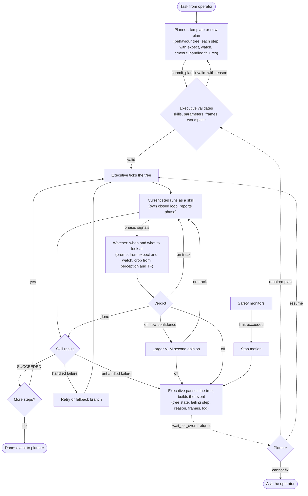
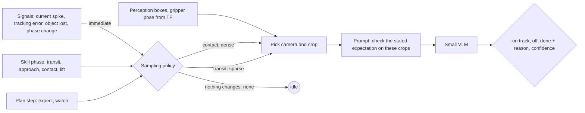

# ADR-0006: Plan, execute, watch: task execution with a planner, a behaviour-tree executive and a visual watcher

- Status: Proposed
- Date: 2026-10-31

## Context

The robot can drive, move its arms and head, and find objects (ADR-0005). An agent drives it through the MCP server one
call at a time. That works for single actions, but a task ("put the yellow cube in the bin") needs tens of steps, and
calling a large model for each one is slow and costly, and blind between calls: nothing notices that the cube slipped
or that someone moved it until the next call happens to look.

The opposite, a fixed script, cannot reason about a failure it was not written for. What is wanted is a large model
that reasons and plans, a fast executive that runs the plan and its closed loops, and a cheap, fast observer that
notices when reality leaves the plan and wakes the planner.

Constraints that shape the design:

- The Jetson Orin NX (16 GB) already holds the stack and the perception models. A GPU workstation on the network has
  far more headroom but is not part of the ROS graph (ROS discovery stays on the robot), so it is reached over HTTP
  like the perception backends.
- Vision-language models answer in hundreds of milliseconds to seconds. They cannot be in a control or safety loop.
- The arms reach to about 5 mm open loop, the last centimetre of a grasp is closed on the wrist camera, and grasping
  waits for the parallel gripper.

## Decision

Five layers, separated by how fast they run:

| Layer | Rate | Runs on | Role |
|---|---|---|---|
| Planner | on request and on wake-up | a large model through MCP | turns a task into a plan, repairs it when the watcher or the executive reports a problem, or asks the operator |
| Executive | 10-50 Hz | Jetson | runs the plan, checks its conditions, retries and takes the fallbacks the plan allows, reports events |
| Skills | own loops, 10-100 Hz | Jetson | one capability each, as ROS 2 actions with typed results |
| Safety | every control cycle | Jetson | servo current and temperature, tracking error, timeouts, e-stop; deterministic code only |
| Watcher | event-driven, about 0-2 Hz | GPU workstation | checks against camera frames that the current step is achieving what the plan expects |

### Plans

A plan is a behaviour tree: sequence, fallback, retry, parallel and condition nodes, and skill nodes with their
parameters. It is a declarative document the planner writes and the executive validates before running (known skills,
parameter types, frames, workspace limits); a plan that fails validation is returned with the reason.
Every skill node carries:

- `expect`: what is true when the step has succeeded, in words for the watcher ("the cube is between the gripper's
  fingers, above the table") and, where possible, as a check the executive can evaluate (the object's pose, a joint
  state, a detection);
- `watch`: what is worth observing during the step (objects, regions, the gripper) and how closely, see the watcher;
- `timeout` and the failure codes the plan handles itself (a retry or a fallback branch); anything else stops the
  tree and wakes the planner.

The executive is `py_trees` in a ROS 2 node: the skills, the perception client and the MCP server are Python, and a
tree in Python is straightforward to build from a plan document. BehaviorTree.CPP (the Nav2 executive) stays the
reference for node semantics, so a plan maps onto it if the executive moves to C++ later.

Recurring tasks are plan templates: a stored tree with parameters ("pick `object` and put it in `container`"). The
planner fills in a template when one fits and writes a new tree only when none does; a new tree that works can be
saved as a template. Templates are validated like any plan.

### Skills

ROS 2 actions on the Jetson with a common contract: a goal with typed parameters, feedback with a phase name (the
watcher uses it), and a result with a code from a fixed list (`SUCCEEDED`, `TIMEOUT`, `NOT_REACHABLE`, `NOT_FOUND`,
`LOST_OBJECT`, `COLLISION`, `SAFETY_STOP`, `PREEMPTED`). First set: `navigate_to` (waypoint or pose), `look_at`,
`detect` (ADR-0005), `move_arm` (saved position or Cartesian point), `approach` (pre-grasp pose above an object),
`touch`; with the parallel gripper `align_with_wrist_camera`, `grasp`, `lift`, `place`. A learned policy (for example
ACT or SmolVLA through LeRobot) can be a skill with the same contract, for the contact-heavy steps.

### Planner interface

The planner keeps using the MCP server, with execution tools added: `submit_plan`, `get_execution_state`,
`wait_for_event` (blocks until the plan finishes, fails or the watcher reports, then returns the event with the tree's
state, the failing step, the watcher's reason, a few frames and the recent log), `pause`, `resume`, `abort`. MCP calls
are requests, so `wait_for_event` is how the robot wakes the planner. The existing single-action tools stay for
interactive use.

`describe_scene` gives the planner a scene graph: a camera frame with every detected object marked and numbered (box
or mask outline and an ID), and the same IDs as a list with label, pose in `base_footprint`, size, confidence and
relations (on, next to, inside). The detectors and mask models behind it are the ADR-0005 backends (OWLv2, SAM and
others). A frontier model reads the scene's meaning well from a plain image, but not exact positions, counts of small
objects or anything metric; the marks give the planner and the skills shared names, so "approach object 3" in a plan
means exactly the object the skill acts on. The plain image stays available when only understanding is needed.

### Watcher

The watcher decides what to look at, when and how closely, instead of sampling at a fixed rate:

- Whatever the executive can check itself (an object's pose from perception, a joint state, the gripper's position)
  it checks itself; the watcher is asked only what needs vision and judgement.
- The prompt comes from the current step's `expect` and `watch`, so the model checks a stated expectation instead of
  describing the scene.
- The frames are cropped to what the step is about (the object's box from perception, the gripper projected through
  TF), from the head or a wrist camera: the camera is chosen per check, since the arm often hides the object from the
  head while the wrist camera sees it.
- The sampling follows the step: dense around contact (closing the gripper, lifting, placing), sparse during transit,
  none while nothing changes, and immediately when the executive reports a deterministic signal (current spike,
  tracking error, the object lost by perception) or a phase change.
- It answers `on_track`, `off` or `done` with a short reason and a confidence. An `off` with low confidence is checked
  by a larger vision-language model before anything else happens, so a false alarm costs a second opinion, not a
  planner call. A confirmed `off` makes the executive pause the tree and wake the planner. The watcher never commands
  motion and is never part of safety.

The first model is a small Cosmos Reason on the workstation GPU, behind the same HTTP backend interface as the
perception models. If it is too slow or too inaccurate, a larger vision-language model on a bigger GPU replaces it. The
bar: a check costs well under what a planner call costs and answers in under a second.

Plans, events, watcher verdicts with their frames, and planner calls are logged per task. They are the data for the
watcher's offline benchmark, for tuning its prompts, and later for a cheaper planner.

## Flow

## Measurements

1. Watcher, offline: on recorded runs with labelled outcomes (success, cube moved, cube dropped, wrong object, occluded),
   the accuracy of `on_track`/`off`/`done`, the latency per check, and the tokens per task, against sampling at a
   constant 1 Hz.
2. End to end, before the gripper: "drive to the desk, find the cube, touch it" with failures injected (the cube moved
   or covered during the approach, a person in the way). Reported: time from the failure to the planner being woken,
   false alarms per task, planner calls and tokens per task, and how often the repaired plan completes.
3. The same with grasp and place once the parallel gripper is on.

## Out of scope

Training learned skills, the gripper's design and its tool-centre-point calibration, speech and dialogue, long-horizon
memory beyond the spatial memory the MCP server has, and running the planner on the robot.

## Consequences

- The planner reasons about tasks and failures, not about each motion, so a task costs a few planner calls instead of
  one per step.
- Skills and the executive must report precise failure codes and phases; a skill that only says "failed" makes the
  watcher and the planner guess.
- The watcher adds a network dependency. When it is unreachable the executive keeps running on its deterministic
  checks and reports the watcher as absent; it does not stop the robot.
- Plans are documents, so they can be logged, replayed against recordings, and compared, which is also the data for
  improving the planner's prompts and, later, a cheaper planner.
